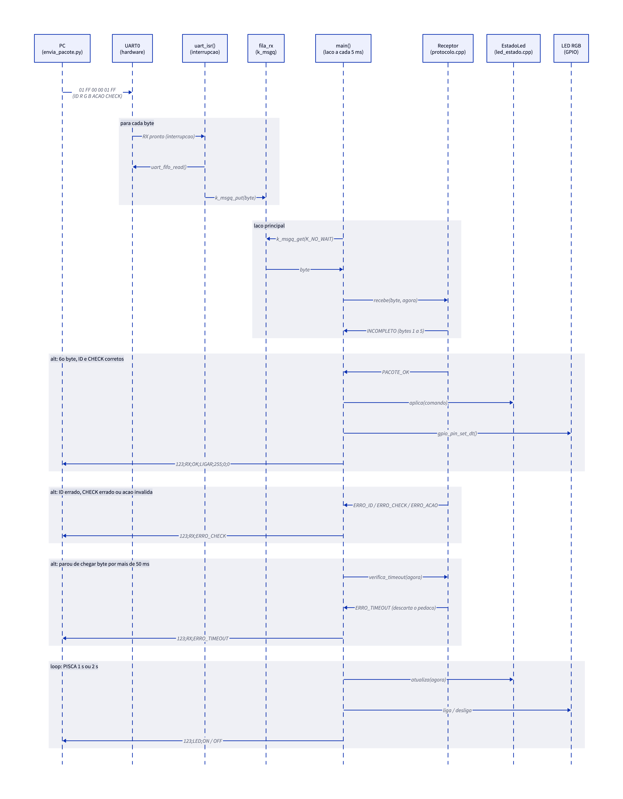

# Controle de LEDs pela UART: PSI Microcontroladores 2

**Repositório:** https://github.com/yjmoreno/Aula-10---Atividade-controle-de-LEDs-pela-UART

| Nome | Nº USP | GitHub |
|---|---|---|
| Yara Joyce Moreno Rodrigues | 16905311 | yjmoreno |
| Giovanna Cristina de Santana | 17892651 | giovannasantt |

## 1. O que o sistema faz

A FRDM-KL25Z recebe pela UART (USB da placa, 115200 bps, 8N1) pacotes de 6 bytes e controla o LED RGB da placa.

| Byte | 0 | 1 | 2 | 3 | 4 | 5 |
|---|---|---|---|---|---|---|
| Campo | ID | R | G | B | AÇÃO | CHECK |

| AÇÃO | Código | Efeito no LED |
|---|---|---|
| LIGAR | 0x01 | Acende com a cor R, G, B |
| DESLIGAR | 0x02 | Apaga |
| TOGGLE | 0x03 | Inverte aceso/apagado |
| PISCA 1 s | 0x04 | 1 s aceso, 1 s apagado |
| PISCA 2 s | 0x05 | 2 s aceso, 2 s apagado |

O ID da nossa placa é 0x01 e o CHECK é o XOR dos 5 primeiros bytes. Exemplo: LIGAR vermelho = `01 FF 00 00 01 FF`. O LED RGB da placa é digital, então cada cor acende se o valor for maior que zero.

Um pacote inválido (ID errado, CHECK errado, ação desconhecida) é descartado e aparece no log, sem travar nada. Se o pacote parar no meio e ficar mais de 50 ms sem chegar byte, o pedaço é descartado (timeout).

## 2. Como o código está organizado

Separamos a lógica do hardware, para conseguir testar a lógica no computador.

| Arquivo | O que faz |
|---|---|
| `firmware/src/protocolo.cpp` | Classe `Receptor`: junta os 6 bytes, confere ID, CHECK e ação, e cuida do timeout. Não usa Zephyr |
| `firmware/src/led_estado.cpp` | Classe `EstadoLed`: o que cada ação faz e o pisca. Não usa Zephyr |
| `firmware/src/main.cpp` | Interrupção da UART, fila de bytes, laço principal e pinos do LED |
| `testes/test_protocolo.cpp` | 26 testes que rodam no computador |
| `ferramentas/envia_pacote.py` | Manda pacotes para a placa e roda o roteiro de testes na placa |
| `testes/placa_falsa.cpp` | A mesma lógica da placa, rodando no computador, para testar o script sem a placa |

A recepção é por interrupção: a 115200 bps chega um byte a cada ~87 µs, rápido demais para ler por polling. A interrupção só coloca o byte numa fila (`k_msgq`). A cada 5 ms o laço principal esvazia a fila, passa os bytes para o `Receptor`, atualiza o pisca e acende o LED.

Diagrama de sequência (código em `docs/sequence-diagrams/sequencia_pacote.d2`, gerado no play.d2lang.com):



## 3. Testes

Fizemos dois tipos de teste:

- **No computador** (`cd testes && ./roda_testes.sh`): 26 testes do protocolo e do LED.
- **Na placa** (`envia_pacote.py --roteiro`): 12 casos. O script manda os pacotes, lê o log da placa e confere sozinho.

| Caso típico do material | Testes no computador | Testes na placa |
|---|---|---|
| Entrada válida simples | T01, T02, T03 | P01, P02, P03 |
| Entrada vazia | T04 | P10 |
| Buffer grande | T11 (1000 pacotes), T12 (10000 bytes de lixo) | P09 (50 pacotes seguidos) |
| Transmissão interrompida | T08, T09, T13, T33 | P07, P08 |
| RX desabilitado | T31 (UART que nunca entrega byte) | – |
| ID errado, CHECK errado, ação inválida | T05, T06, T07, T10, T16 | P04, P05, P06 |
| Ações do LED | T20 a T25 | P11, P12 (tempo do pisca) |
| Bônus CRC-8 | T14, T15 | – |

## 4. TDD: os erros que apareceram e como corrigimos

Seguimos o ciclo do TDD: escrever o teste, ver falhar, implementar o mínimo, ver passar e refatorar. As saídas de cada etapa estão em `docs/evidence/`.

### 4.1 Primeiro ciclo: testes antes do código

**Teste falhando.** Escrevemos os 25 testes com as funções ainda vazias:

```
[FALHOU] T01 entrada valida simples
    FALHOU linha 59: check_xor(d, 5) == 0xFF
[FALHOU] T02 CHECK por XOR
...
3 de 25 testes passaram
```

**Por que falhou.** Não tinha código ainda. Os 3 que passaram (entrada vazia, DESLIGAR e RX desabilitado) são os casos em que "não fazer nada" já é o certo.

**Correção.** Implementamos o mínimo para passar, sem nos preocupar com o código bonito.

**Funcionando.** 25 de 25. Evidências: [1_vermelho.txt](docs/evidence/tdd/1_vermelho.txt) e [2_verde.txt](docs/evidence/tdd/2_verde.txt).

### 4.2 Erro na refatoração: `>` virou `>=`

Na refatoração, juntamos a conferência do prazo numa função só (`passou_do_prazo`), e na hora escrevemos `>=` no lugar de `>`.

**Teste falhando.**

```
    FALHOU linha 191: rx.comando().acao == ACAO_LIGAR
[FALHOU] T13 intervalo igual ao timeout
24 de 25 testes passaram
```

**Por que falhou.** Com `>=`, um byte que chega exatamente 50 ms depois do anterior já descartava o pacote. O certo é descartar só quando passar de 50 ms.

**Correção.** Voltamos para `>`.

**Funcionando.** 25 de 25 de novo. Evidências: [3a_refatoracao_com_deslize.txt](docs/evidence/tdd/3a_refatoracao_com_deslize.txt) e [3b_refatorado_verde.txt](docs/evidence/tdd/3b_refatorado_verde.txt).

O que mudou na refatoração: em `EstadoLed::aplica` havia cinco `if` seguidos, todos copiando a cor. Agora a cor é copiada uma vez e um `switch` decide o que fazer:

```cpp
// antes
if (c.acao == ACAO_LIGAR) {
    cor_r = c.r; cor_g = c.g; cor_b = c.b;
    ligado = true;
    pisca_ms = 0;
}
if (c.acao == ACAO_DESLIGAR) { ligado = false; pisca_ms = 0; }
if (c.acao == ACAO_TOGGLE) {
    cor_r = c.r; cor_g = c.g; cor_b = c.b;
    ligado = !ligado;
    pisca_ms = 0;
}
// ... e mais dois blocos iguais para os piscas
```

```cpp
// depois
if (c.acao != ACAO_DESLIGAR) {        /* so o DESLIGAR nao muda a cor */
    cor_r = c.r; cor_g = c.g; cor_b = c.b;
}
pisca_ms = 0;

switch (c.acao) {
case ACAO_LIGAR:    ligado = true;    break;
case ACAO_DESLIGAR: ligado = false;   break;
case ACAO_TOGGLE:   ligado = !ligado; break;
case ACAO_PISCA_1S: inicia_pisca(1000, agora_ms); break;
case ACAO_PISCA_2S: inicia_pisca(2000, agora_ms); break;
}
```

No `Receptor`, o XOR feito à mão (`buf[0] ^ buf[1] ^ ...`) virou chamada de `check_xor()`, e os índices `buf[4]` e `buf[5]` ganharam nomes (`POS_ACAO`, `POS_CHECK`). O diff completo está em [refatoracao.diff](docs/evidence/tdd/refatoracao.diff).

### 4.3 Pacote de outro ID criava um pacote falso

Os testes no computador passavam, mas o roteiro rodando contra a placa falsa falhou no P04 (pacote com ID errado).

**Teste falhando.** O pacote enviado foi `02 FF FF FF 01 FC`. Em vez de um único `ERRO_ID`, veio isto ([log](docs/evidence/tdd/4a_roteiro_achou_bug_id.txt)):

```
1740;RX;ERRO_ID
1740;RX;ERRO_ID
1740;RX;ERRO_ID
1740;RX;ERRO_ID
1792;RX;ERRO_TIMEOUT
```

**Por que falhou.** O receptor descartava o `02` e continuava procurando um início de pacote byte a byte. O `01` da AÇÃO é igual ao nosso ID e virava o começo de um pacote falso. Se um pacote nosso chegasse logo depois, ele se misturava com esse e era perdido.

**Correção.** Primeiro escrevemos o teste T16, que reproduz o problema (24 de 26, [log](docs/evidence/tdd/4b_vermelho_bug_id.txt)). Depois mudamos o receptor para sempre juntar os 6 bytes e conferir o ID no fim, junto com o CHECK. Assim, o pacote de outro ID é pulado inteiro.

**Funcionando.** 26 de 26 no computador ([log](docs/evidence/tdd/4c_verde_bug_id.txt)) e 12 de 12 na placa falsa ([log](docs/evidence/simulacao/roteiro_placa_falsa.txt)).

### 4.4 Na placa de verdade, a fila da UART enchia

**Teste falhando.** Na primeira vez na placa deu 11 de 12. O P09 (50 pacotes seguidos, 300 bytes) teve só 11 OK:

```
71098;RX;OK;LIGAR;9;0;0
71100;RX;OK;LIGAR;10;0;0
71103;RX;ERRO_CHECK
71105;RX;ERRO_ID
71106;RX;ERRO_CHECK
...
[FALHOU] P09 buffer grande: 50 pacotes seguidos (300 bytes)  (11 de 50 OK)
```

**Por que falhou.** Os 300 bytes chegam em ~26 ms, mas a placa leva ~2 ms por pacote, porque escreve uma linha de log na serial para cada um. A fila tinha 64 bytes. Ela encheu, a interrupção perdeu os bytes que não couberam, e os pacotes seguintes chegaram desalinhados. A placa falsa não pegava isso porque, no computador, a porta virtual tem buffer grande e não perde byte.

**Correção.** Aumentamos a fila para 512 bytes e colocamos um aviso `RX;BYTES_PERDIDOS` no log, caso algum byte ainda se perca. A RAM usada foi de 24,8% para 27,5%.

**Funcionando.** 12 de 12 na placa, com o P09 em 50 de 50:

```
[  OK  ] P09 buffer grande: 50 pacotes seguidos (300 bytes)  (50 de 50 OK)
[  OK  ] P10 entrada vazia: 2 s sem enviar nada  (0 linhas RX)
[  OK  ] P11 PISCA 1 s  (intervalos [997, 1001, 1001, 1001] ms)
[  OK  ] P12 PISCA 2 s  (intervalos [2001, 2001, 2000] ms)

12 de 12 casos passaram
```

Evidências: [terminal com falha](docs/evidence/placa/terminal_roteiro_1_fila64.txt), [log com falha](docs/evidence/placa/roteiro_placa_1_fila64_falhou_P09.txt), [vídeo com falha](docs/evidence/placa/roteiro_placa_1_fila64_video.mp4), [terminal funcionando](docs/evidence/placa/terminal_roteiro_2_fila512.txt), [log funcionando](docs/evidence/placa/roteiro_placa_2_fila512_12de12.txt), [vídeo funcionando](docs/evidence/placa/roteiro_placa_2_fila512_video.mp4).

## 5. Resultados finais

| Testes | Resultado |
|---|---|
| Computador (protocolo e LED) | 26 de 26 |
| Placa falsa (script) | 12 de 12 |
| Placa FRDM-KL25Z | 12 de 12 |

| ID | Caso na placa | Resultado |
|---|---|---|
| P01 | LIGAR vermelho | PASSOU |
| P02 | DESLIGAR | PASSOU |
| P03 | TOGGLE duas vezes | PASSOU |
| P04 | ID errado | PASSOU (só `ERRO_ID`) |
| P05 | CHECK errado | PASSOU (só `ERRO_CHECK`) |
| P06 | Ação 0x09 | PASSOU (`ERRO_ACAO`) |
| P07 | Pacote truncado (3 bytes) | PASSOU (`ERRO_TIMEOUT`) |
| P08 | Lixo, silêncio e pacote válido | PASSOU |
| P09 | 50 pacotes seguidos | PASSOU (50 de 50), depois da correção da fila |
| P10 | 2 s sem enviar nada | PASSOU |
| P11 | PISCA 1 s | PASSOU (997–1001 ms) |
| P12 | PISCA 2 s | PASSOU (2000–2001 ms) |

## 6. Bônus

- **CRC-8: feito.** Basta mudar `USA_CRC8` para `true` no `main.cpp` e usar `--crc8` no script. Testes T14 e T15.
- **PWM: não feito.** Na versão do Zephyr que o PlatformIO usa, a KL25Z não tem os timers (TPM) declarados no devicetree. Para usar PWM seria preciso escrever um overlay de devicetree, e deixamos de fora para manter o código simples.

## 7. Como rodar

| O quê | Comando |
|---|---|
| Testes no computador | `cd testes && ./roda_testes.sh` |
| Gravar a placa | Abrir a pasta `firmware/` no VS Code → PlatformIO → Upload |
| Mandar um pacote | `~/.platformio/penv/bin/python ferramentas/envia_pacote.py PORTA ligar 255 0 0` |
| Roteiro na placa | `~/.platformio/penv/bin/python ferramentas/envia_pacote.py PORTA --roteiro --saida docs/evidence/placa/roteiro_placa.txt` |

A porta no Mac aparece com `ls /dev/cu.usbmodem*`. Usamos o Python do PlatformIO porque ele já tem o `pyserial`. O monitor serial do VS Code precisa estar fechado, senão ele ocupa a porta.

## 8. Uso de IA

Usamos o Claude (Anthropic) como apoio durante o desenvolvimento. A dupla rodou os testes, gravou a placa, executou o roteiro, analisou as falhas e registrou as evidências.
